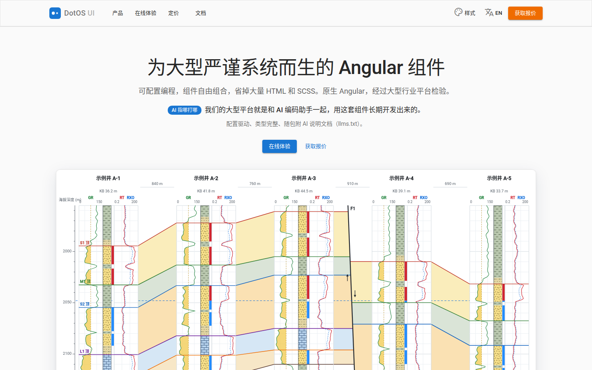

# @dotos/dui

<p align="center">
  <a href="https://dui.dotos.com"><b>🌐 Website / 官网</b></a> ·
  <a href="https://dui.dotos.com/demo"><b>▶ Live demo / 在线体验</b></a> ·
  <a href="https://dui.dotos.com/products/dui"><b>📘 Docs / 文档</b></a> ·
  <a href="https://dui.dotos.com/contact"><b>✉ Contact / 联系我们</b></a>
</p>

<p align="center">
  <a href="https://dui.dotos.com"></a>
</p>

**为 Angular 22 打造、在生产系统里长出来的企业级 UI 基础库。**
95 个按需引入的入口、220 个组件、运行时三态换肤、12 种语言 —— 开箱即可搭建高密度的企业后台。

`Angular 22` · `MIT 开源` · `95 个独立入口` · `12 种语言` · `中英双语 API 文档` · `内置 llms.txt`

---

## 纯 Angular，原生 Material

dui 只做一件事：**做 Angular 生态里最地道的企业组件库。**

- **长在 Angular Material 与 CDK 之上**，不是另起一套设计体系。按钮、表单、浮层、对话框沿用 Material 的组件与交互，主题服务按 Material 调色板实时生成全套样式 —— 放进你现有的 Material 应用里，看起来就是一家人。
- **只为 Angular 写**，没有"一套核心适配多个框架"的包装层。依赖注入、变更检测、模板语法、`NgModule` / standalone，全部是 Angular 原生写法，你的团队怎么写 Angular，就怎么用 dui。
- **紧跟 Angular 大版本**：8.x 已经运行在 Angular 22 上，并有门禁专门保证不使用新版本已删除的 API，升级 Angular 不必等组件库。

## AI 开发友好：大模型时代的编程契约

dui 不仅是 UI 库，更是专为 AI 编程代理（AI Coding Agents）深度优化的**工程协议底座**。

- **LLM 语义地图 (`llms.txt`)**：npm 包内置标准化 `llms.txt`。AI Agent 通过它即可瞬间建立全局上下文：完整的子入口路径、组件选择器与精确的输入输出签名，直接消除 Agent 因 hallucination (幻觉) 导致的 API 调用错误。
- **双语语境对齐 (`@zh` JSDoc)**：14,000 多条 API 文档强制执行中英双语 JSDoc 规范。Agent 在处理你的中文业务需求时，能够通过双语对照精准理解 API 的每一个设计细节，避免「中转英」带来的语义丢失。
- **可证实的工程契约**：我们的 CI 门禁不仅仅是为了人，更是给 Agent 的「反馈循环」。Agent 写的代码若触碰了「any 限制」、「类型契约收缩」、「不安全求值」等红线，CI 会返回明确的错误指令，Agent 可基于此实现自动重试与自我纠偏（Self-Correction）。

---

## 为什么选择 dui

| | |
|---|---|
| **不是 Demo，是现役装备** | dui 是 DotOS 平台主应用、SmartField 智能油田、Geo-BIM 空间平台等 15 个产品与模块的共同底座，内部 3,000 多个源文件直接依赖它。你拿到的就是我们每天在生产里跑的那一份代码。 |
| **原生 Angular 22** | 标准 Angular Package Format（FESM2022）、Ivy 部分编译产物，可直接放进 standalone 组件的 `imports`，也可用于传统 `NgModule` 工程。 |
| **够全，少拼凑** | 95 个二级入口覆盖表单、表格、树、布局、浮层、窗口、颜色与图标、权限与存储等，220 个组件、117 个指令、26 个管道。一个依赖替代十几个零散的第三方包。 |
| **轻，按需引入** | 主入口刻意不导出任何内容，一切从 `@dotos/dui/<模块>` 引入，`sideEffects: false`，打包器只保留用到的部分。Monaco、ProseMirror、xterm 等重型编辑器已全部移出核心包，运行时依赖只有 7 个轻量工具包。 |
| **运行时换肤** | 任意 Material 色板组合主色 / 强调色 / 警告色，亮色、暗色、工业深蓝三种底色，宽松 / 标准 / 紧凑三档密度，切换即生效、无需刷新，并自动记住用户选择。 |
| **面向全球交付** | 12 种语言包（简中、繁中、英、日、韩、德、法、西、葡、俄、印尼、阿拉伯），由门禁保证各语种键完全对齐、不允许"照抄英文"。 |
| **AI 编程友好** | npm 包内自带 `llms.txt`，收录入口路径、组件选择器与输入输出签名，方便 Cursor、Claude Code 等编程助手调用。 |
| **中文团队友好** | 全部公开 API 带中英双语 JSDoc（`@zh` 标签，14,000 多条，95 个入口全覆盖），IDE 悬停即见中英文说明。 |

---

## 能力一览

| 类别 | 入口（`@dotos/dui/...`） | 主要内容 |
|---|---|---|
| **表单** | `form`、`form/date`、`form/range`、`form/toggle-select`、`form/card` | JSON 配置驱动表单 `dui-form`；文本、数字、下拉（带搜索）、复选、单选、开关、滑块、日期 / 日期时间 / 日期区间、数值区间、颜色 / 图标选择、可重复分组等字段组件 |
| **数据展示** | `data/datatable`、`data/cardview`、`data/paging`、`tree` | `dui-datatable`：虚拟滚动、分组、行详情、树形、汇总行；`tree-root`：拖拽、复选、懒加载、虚拟视口；卡片视图；分页条 |
| **布局** | `container`、`container/layout`、`container/dock-layout` | 面板、标签页、手风琴、可拖拽网格布局、分割面板、信息抽屉、应用外壳 `dui-layout`、IDE 式停靠布局 |
| **导航与命令** | `ui/button`、`ui/menu`、`ui/context-menu`、`ui/toolbar`、`ui/topbar`、`ui/speeddial`、`ux/command-palette` | 按钮、菜单栏、右键菜单、工具栏、顶栏、悬浮操作按钮、面包屑、模糊搜索命令面板 |
| **反馈与浮层** | `common/dialogs`、`common/toastr`、`common/loading`、`common/popover`、`net` | 提示 / 确认 / 输入 / 状态对话框（手机端自动全屏）、消息通知、加载遮罩、HTTP 加载指示 |
| **窗口** | `ux/windows`、`ux/multi-window` | 页内可拖拽 / 缩放的多窗口、跨浏览器窗口协同 |
| **增强组件** | `ux/query-builder`、`ux/highlight`、`ux/avatar`、`ux/iconpicker`、`ux/link-preview` | 可视化查询条件构建器、代码高亮、头像、图标选择器、链接预览 |
| **颜色 / 图标** | `common/colorpicker/*`、`common/matcolorpicker`、`common/icon`、`common/icon-sprite`、`common/inline-svg` | 多种风格的颜色选择器、图标与雪碧图、内联 SVG |
| **交互指令** | `common/dnd`、`common/dragselect`、`common/resize-element`、`common/keyboard`、`common/clipboard`、`common/print` | 拖放、框选、拖拽缩放、快捷键与帮助面板、复制、打印 |
| **主题与国际化** | `theme`、`theming/*`、`translator` | 运行时主题服务、组件级主题、SCSS 色板；翻译服务、管道、指令与 12 种语言包 |
| **核心服务** | `core/auth`、`core/config`、`core/storage`、`core/cache`、`core/mobx` 等 | JWT 认证与守卫、锁屏、特性开关 `[duiFeature]`、本地存储、缓存、MobX 集成 |
| **工具** | `util`、`util/pipes`、`base` | 常用管道、DOM / 观察者 / 移动端识别等底层工具 |

> 富文本、Markdown、Monaco 代码编辑器、终端、JSON 编辑器在 8.0 起归入 [@dotos/duix](../duix/README.md)，保持 dui 核心轻量。

---

## 快速开始

### 1. 安装

> 当前通过 GitHub Packages 分发，需要读包令牌（向我们索取）。

```ini
# .npmrc
@dotos1:registry=https://npm.pkg.github.com/
//npm.pkg.github.com/:_authToken=<你的令牌>
```

```jsonc
// package.json
"dependencies": {
  "@dotos/dui": "npm:@dotos1/dui@8.0.0-next.6"
}
```

对等依赖（宿主工程提供）：

```bash
npm i @angular/animations@^22 @angular/cdk@^22 @angular/common@^22 @angular/core@^22 \
      @angular/forms@^22 @angular/material@^22 @angular/platform-browser@^22 @angular/router@^22 \
      rxjs@^7.8 lodash-es@^4.17.21 mobx@^6 moment@^2.29
```

可选：`@angular/material-moment-adapter`（Moment 日期适配器）、`highlight.js`（代码高亮）。

### 2. 初始化根模块

与我们自己的 Angular 22 主应用相同的初始化方式：

```ts
import { Injector, NgModule } from '@angular/core';
import { BrowserModule } from '@angular/platform-browser';
import { BrowserAnimationsModule } from '@angular/platform-browser/animations';
import { provideHttpClient, withInterceptorsFromDi } from '@angular/common/http';
import { ServiceLocator } from '@dotos/dui/core/services';
import { LocalStorageService } from '@dotos/dui/core/storage';
import { HttpLoaderModule } from '@dotos/dui/net';
import { ToastrModule } from '@dotos/dui/common/toastr';
import { DotosConfigModule, DotosConfigService, ThemeService, dotosConfig } from '@dotos/dui/theme';
import { TranslateModule, TranslateService, TranslationService } from '@dotos/dui/translator';

@NgModule({
  declarations: [AppComponent],
  imports: [
    BrowserModule, BrowserAnimationsModule,
    DotosConfigModule.forRoot(dotosConfig),
    HttpLoaderModule.forRoot(),
    ToastrModule.forRoot(),
    TranslateModule.forRoot(),
  ],
  providers: [
    { provide: ThemeService, useFactory: () => ThemeService.getInstance() },
    { provide: 'LOCAL_STORAGE_SERVICE_CONFIG', useValue: { prefix: 'dotos', storageType: 'localStorage' } },
    LocalStorageService, TranslationService, TranslateService, DotosConfigService,
    { provide: 'apiBase', useValue: '/api' },
    provideHttpClient(withInterceptorsFromDi()),
  ],
  bootstrap: [AppComponent],
})
export class AppModule {
  constructor(injector: Injector, translation: TranslationService) {
    ServiceLocator.injector = injector;               // 主题服务依赖它
    translation.addTranslationFolder('public', 'i18n');
  }
}
```

### 3. 引入样式与语言包

```scss
/* src/styles.scss */
@use '@dotos/dui/theming/platform';
```

把包内 `i18n/` 目录拷到应用的 `assets/i18n/`。

### 4. 使用组件

```ts
import { Component } from '@angular/core';
import { FormModule } from '@dotos/dui/form';
import { ButtonModule } from '@dotos/dui/ui/button';

@Component({
  selector: 'app-quick-form',
  imports: [FormModule, ButtonModule],
  template: `
    <dui-form [config]="formConfig"></dui-form>
    <dui-button type="mat-raised-button" color="primary" text="保存" (click)="save()"></dui-button>
  `,
})
export class QuickFormComponent {
  formConfig = {
    items: [
      { xtype: 'text-field',   name: 'name',   label: '名称', required: true, wrappers: ['form-field'] },
      { xtype: 'select-field', name: 'region', label: '区域', wrappers: ['form-field'],
        options: [{ label: '华北', value: 'north' }, { label: '华东', value: 'east' }] },
    ],
  };
  save() {}
}
```

### 5. 运行时换肤

```ts
constructor(private dotosConfig: DotosConfigService) {}

applyTheme(type: 'light' | 'dark' | 'darkblue') {
  this.dotosConfig.config = {
    theme: { type, primary: 'blue-500', accent: 'orange-500', warn: 'red-500' },
  };
}
```

---

## 质量保障

每次提交都由 CI 逐项把关：

| 门禁 | 保证什么 |
|---|---|
| `gate:tsc` | 全部入口通过类型检查 |
| `gate:any` | 类型逃逸（`any`、绕过断言）只减不增 |
| `gate:i18n` | 12 种语言键集合完全一致，非英语不得照抄英文 |
| `gate:jsdoc` | 文档中的类型与真实类型一致，中文说明用语规范 |
| `gate:esm` | 全库纯 ESM，可被摇树优化 |
| `gate:ng22-compat` | 不使用 Angular 22 已删除的 API，强制部分编译 |
| `gate:style-ref` | Material 样式变量新旧双写，平滑升级 |

包内附带 `THIRD-PARTY-NOTICES.md`，列明全部依赖的许可证。

---

## 文档与示例

仓库自带文档站 **testdui**：组件导航树、模块概览、由源码自动生成的 API 参考，以及各模块的交互示例与主题设置面板。

```bash
yarn install
npm start          # http://localhost:4400
```

---

## 兼容性

| 项 | 说明 |
|---|---|
| Angular | **22.x**（8.x，当前 8.0.0-next.6）；Angular 18 项目可使用 7.x 维护线 |
| 组件形态 | 以 NgModule 封装，可直接在 standalone 组件的 `imports` 中使用 |
| 运行环境 | 现代浏览器；手机端已适配触摸目标与全屏对话框 |
| 服务端渲染 | 暂不支持 |
| 从右到左（RTL） | 部分支持 |

---

## 许可

dui 以 **MIT 许可** 开源，可免费用于商业项目。

需要复杂数据网格、甘特图、透视分析、日程、看板、文件预览、富文本与代码编辑器？请看
**[@dotos/duix](../duix/README.md)** —— 与 dui 同一套主题和语言体系的企业级扩展组件库。

---

## 关于我们

北京商典信息科技有限公司 · [www.dotos.com](https://www.dotos.com)
商务与技术支持：`<待填写联系邮箱>`
